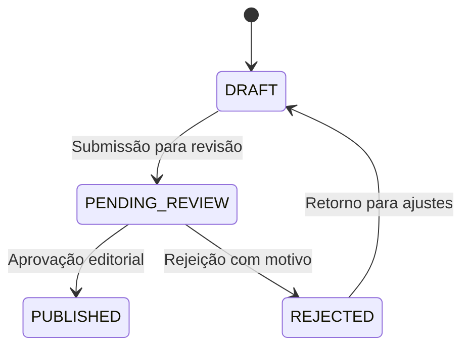

# Fluxo editorial e limites do MVP

Este documento registra a máquina de estados editoriais do `Post`, as responsabilidades por papel e as decisões e limites do MVP da API.

## Estados e transições do Post

O ciclo de vida de uma publicação segue o enum `PostStatus` e as transições válidas definidas em [`src/post/domain/post-status.ts`](../../src/post/domain/post-status.ts):

| Estado           | Visibilidade pública | Edição pelo autor | Próximos estados permitidos |
| ---------------- | -------------------- | ----------------- | --------------------------- |
| `DRAFT`          | Não                  | Sim               | `PENDING_REVIEW`            |
| `PENDING_REVIEW` | Não                  | Não               | `PUBLISHED`, `REJECTED`     |
| `PUBLISHED`      | Sim                  | Não               | Nenhum (estado terminal)    |
| `REJECTED`       | Não                  | Após retorno      | `DRAFT`                     |

A publicação no feed público (`GET /posts` e `GET /posts/:id`) exige `status = PUBLISHED` e `publishedAt` preenchido.

## Responsabilidades por papel

As autorizações de domínio complementam o modelo de autenticação descrito em [Autenticação e usuários](autenticacao-e-usuarios.md):

| Papel            | Capacidades principais no MVP                                                                                                                                  |
| ---------------- | -------------------------------------------------------------------------------------------------------------------------------------------------------------- |
| Público / `USER` | Consulta do feed publicado, leitura de publicações individuais e gestão do próprio perfil autenticado.                                                         |
| `COLLABORATOR`   | Criação e edição dos próprios rascunhos, consulta de trabalhos importados, geração assistida de rascunho e submissão para revisão.                             |
| `ADMIN`          | Todas as permissões editoriais, revisão (aprovação/rejeição com `rejectionReason`), sincronização via `POST /academic-works/sync` e administração de usuários. |

## Limites e decisões do MVP

- **Formato do conteúdo:** publicações do MVP armazenam `title` e `content` em texto simples, sem editor rico ou upload obrigatório de mídia no fluxo editorial.
- **Fonte acadêmica única:** o MVP integra exclusivamente a API pública da Crossref por meio da porta acadêmica, com sincronização manual sob demanda por ISSN e deduplicação por DOI ([ADR 0001](../decisoes/0001-crossref-como-fonte-academica-do-mvp.md)).
- **Geração assistida por IA:** quando habilitada atrás de porta/adaptador (`noop` por padrão; provedor externo opcional fora do domínio editorial), a geração exige trabalho acadêmico com resumo e produz sempre um `Post` em `DRAFT` para revisão humana, nunca publicação automática.
- **Identidade desacoplada:** a API não armazena senhas nem o UID do Firebase no PostgreSQL; `User.id` (UUID v7) é a única chave de domínio persistida, vinculada às custom claims `id` e `roles`.
- **Escopo deliberadamente fora do MVP:** comentários de leitores, curtidas, agendamento futuro de publicação, busca textual avançada e múltiplas fontes acadêmicas simultâneas.
