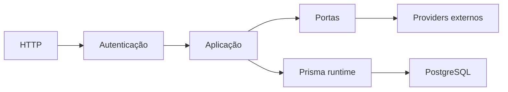

# Visão geral da arquitetura

O template separa entrada HTTP, aplicação, integrações externas e persistência. Os módulos de domínio não dependem de implementações de Firebase, Brevo ou R2; essas integrações ficam atrás de portas e adaptadores.

## Modelo

A autenticação valida o token Firebase e autoriza as roles. Endpoints públicos não exigem token, mas continuam sujeitos às regras específicas de cada rota.

## Integração acadêmica

`POST /academic-works/sync` permite a um administrador com perfil local ativo importar trabalhos de um periódico identificado por ISSN. A aplicação consulta a fonte pela porta acadêmica, persiste `AcademicSource` e `ExternalWork` e usa a unicidade do DOI para ignorar registros já importados. A resposta informa quantos candidatos normalizados foram encontrados, importados e ignorados. Cada chamada percorre no máximo dez páginas de cem itens; quando houver mais resultados, `nextCursor` deve ser enviado como `cursor` em uma nova chamada com os mesmos filtros. A seleção editorial e a tela de consulta pertencem a uma etapa posterior.

## Operação

A aplicação valida sua configuração na inicialização, expõe health checks e pode exportar telemetria OpenTelemetry. A cadeia de entrega constrói e promove uma imagem OCI única; detalhes estão em [CI/CD](../entrega/ci-cd.md) e [Deploy e recuperação](../operacao/deploy-e-recuperacao.md).
