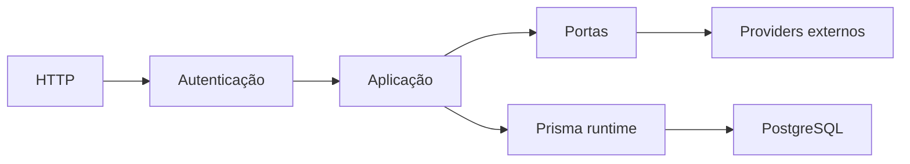

# Visão geral da arquitetura

O template separa entrada HTTP, aplicação, integrações externas e persistência. Os módulos de domínio não dependem de implementações de Firebase, Brevo, R2 ou Google Gemini; essas integrações ficam atrás de portas e adaptadores.

## Modelo

A autenticação valida o token Firebase e autoriza as roles. Endpoints públicos não exigem token, mas continuam sujeitos às regras específicas de cada rota.

## Integração acadêmica

`POST /academic-works/sync` permite a um administrador com perfil local ativo importar trabalhos de um periódico identificado por ISSN. A aplicação consulta a fonte pela porta acadêmica, persiste `AcademicSource` e `ExternalWork` e usa a unicidade do DOI para ignorar registros já importados. A resposta informa quantos candidatos normalizados foram encontrados, importados e ignorados. Cada chamada percorre no máximo dez páginas de cem itens; quando houver mais resultados, `nextCursor` deve ser enviado como `cursor` em uma nova chamada com os mesmos filtros. A seleção editorial e a tela de consulta pertencem a uma etapa posterior.

A escolha da Crossref para o MVP, a evidência da POC e suas limitações estão na [ADR 0001](../decisoes/0001-crossref-como-fonte-academica-do-mvp.md).

## Geração assistida por IA

A integração de IA fica atrás da porta `AiDraftGeneratorPort` no `AiModule`, com suporte aos drivers `noop` (padrão) e `gemini`. O prompt delimita os metadados e o resumo do trabalho para restringir a geração às informações da fonte, exige resposta estruturada em JSON (`title` e `content`) e mapeia falhas em erros tipados (`configuration`, `invalid-input`, `invalid-response`, `timeout`, `unavailable`) sem persistir conteúdo inconsistente.

`POST /posts/from-academic-work` permite a colaboradores e administradores com perfil local ativo gerar um `Post` em `DRAFT` a partir de um `ExternalWork` que possua resumo. O post é persistido com vínculo único (`externalWorkId`) para impedir que o mesmo trabalho origine múltiplos posts por acidente e pode ser editado normalmente pelo fluxo de rascunhos.

## Operação

A aplicação valida sua configuração na inicialização, expõe health checks e pode exportar telemetria OpenTelemetry. A cadeia de entrega constrói e promove uma imagem OCI única; detalhes estão em [CI/CD](../entrega/ci-cd.md) e [Deploy e recuperação](../operacao/deploy-e-recuperacao.md).
