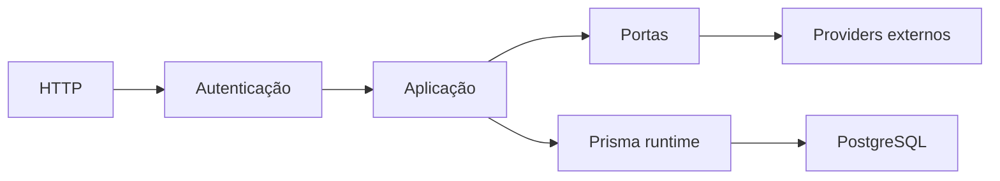

# Visão geral da arquitetura

A API do Despertar para a Ciência separa entrada HTTP, aplicação, integrações externas e persistência. Os módulos de domínio não dependem diretamente de implementações de Firebase, Brevo, R2, Crossref ou provedores de IA; essas integrações ficam atrás de portas e adaptadores.

## Modelo

A autenticação valida o token Firebase e autoriza as roles conforme [Autenticação e usuários](autenticacao-e-usuarios.md). Endpoints públicos não exigem token, mas continuam sujeitos às regras específicas de cada rota.

## Fluxo editorial e limites do MVP

O ciclo de vida de `Post` (`DRAFT`, `PENDING_REVIEW`, `PUBLISHED`, `REJECTED`), as permissões por papel e as decisões e ressalvas de escopo do MVP estão consolidados em [Fluxo editorial e limites do MVP](fluxo-editorial.md).

## Integração acadêmica

`POST /academic-works/sync` permite a um administrador com perfil local ativo importar trabalhos de um periódico identificado por ISSN. A aplicação consulta a fonte pela porta acadêmica, persiste `AcademicSource` e `ExternalWork` e usa a unicidade do DOI para ignorar registros já importados. A resposta informa quantos candidatos normalizados foram encontrados, importados e ignorados. Cada chamada percorre no máximo dez páginas de cem itens; quando houver mais resultados, `nextCursor` deve ser enviado como `cursor` em uma nova chamada com os mesmos filtros.

A escolha da Crossref para o MVP, a evidência da POC e suas limitações estão na [ADR 0001](../decisoes/0001-crossref-como-fonte-academica-do-mvp.md).

## Operação

A aplicação valida sua configuração na inicialização, expõe health checks e pode exportar telemetria OpenTelemetry. A cadeia de entrega constrói e promove uma imagem OCI única; detalhes estão em [CI/CD](../entrega/ci-cd.md) e [Deploy e recuperação](../operacao/deploy-e-recuperacao.md).
